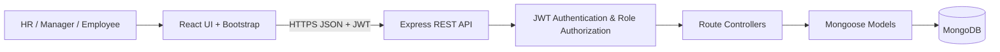
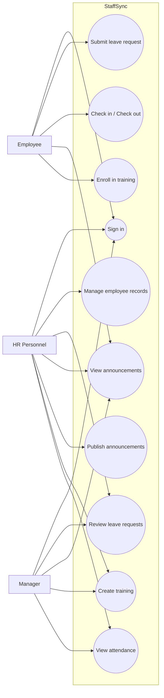
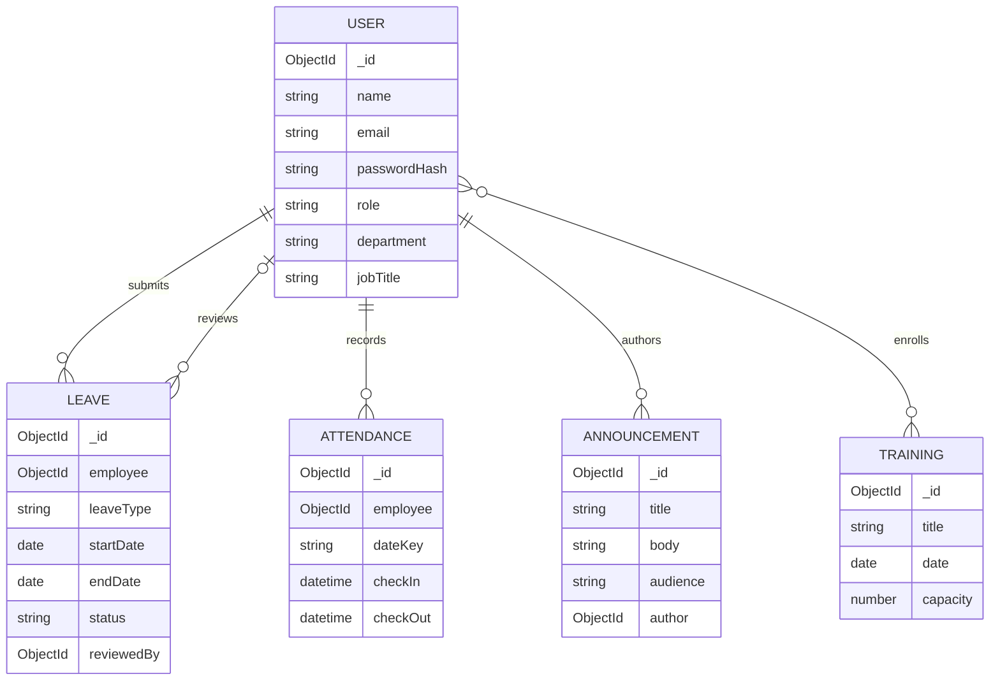
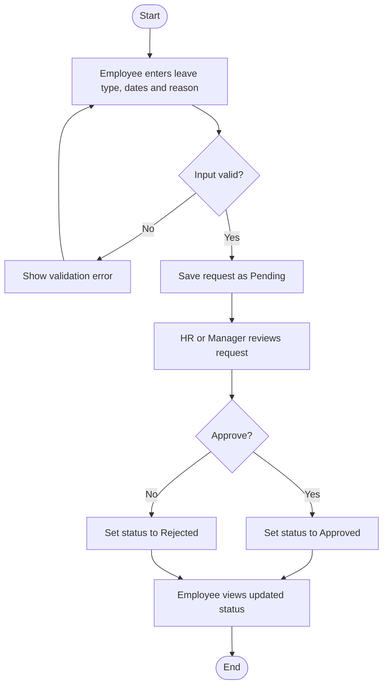
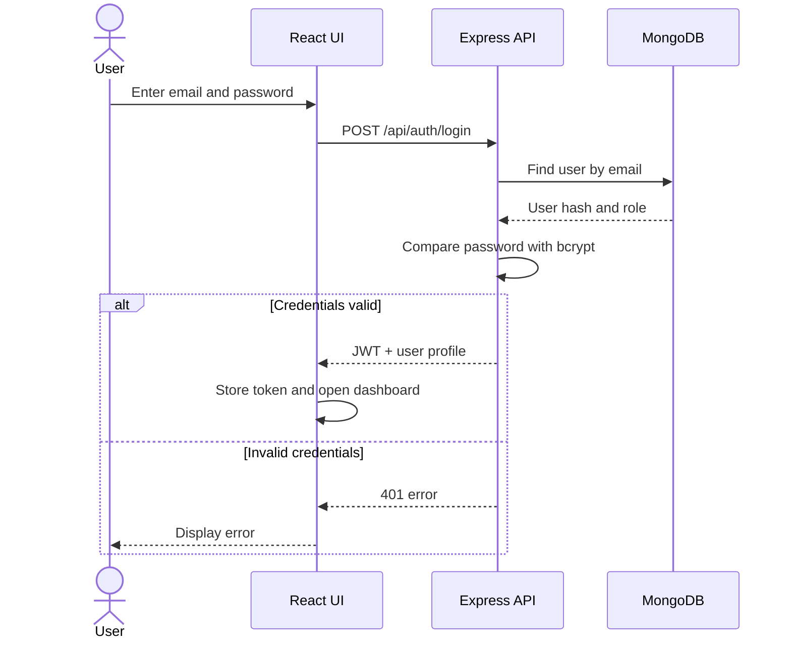
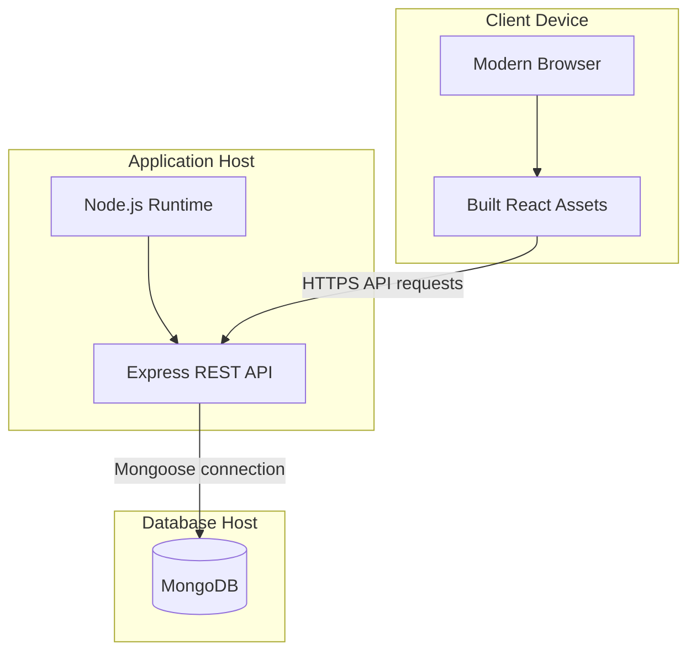

# StaffSync Diagrams

The following Mermaid diagrams can be pasted into Mermaid Live Editor, compatible Markdown viewers, or project documentation.

## 1. System Architecture

## 2. Use Case Diagram

## 3. ER / Data Model

## 4. Leave Approval Activity Diagram

## 5. Login Sequence Diagram

## 6. Deployment Diagram

